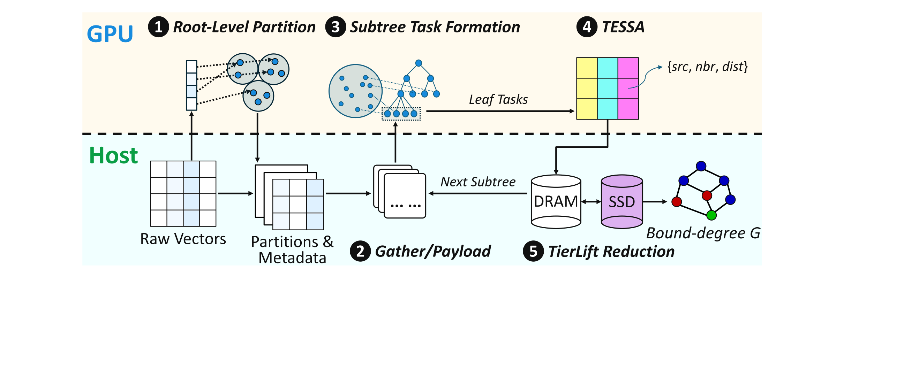

# Breaking the Memory Wall in GPU-Accelerated ANN Graph Construction

This repository contains **SHEAR**, a single-machine GPU--CPU research system for constructing graph-based approximate
nearest-neighbor indexes when the dataset and intermediate construction state exceed GPU memory.

[](docs/pdf/Fig2-Workflow.pdf)

*SHEAR workflow. Click the figure to open the original PDF.*

SHEAR combines three mechanisms:

- **GPU-memory-aware task formation** creates overlapping subtree tasks that fit a fixed device workspace.
- **TESSA** persistently executes recursive assignment and SQ8/Tensor Core leaf evaluation on the GPU.
- **TierLift** reduces streamed candidate records in bounded host memory and spills source ranges to SSD when needed.

The public artifact contains the active construction/search implementation, focused tests, reproducibility runbooks,
paper figures, and a curated text-only experiment archive. Raw datasets, generated indexes, and retired implementations
are not included.

## Requirements

- Linux and the Rust nightly toolchain selected by `rust-toolchain.toml`
- LAPACK, LAPACKE, BLAS, a C++17 compiler, and OpenMP
- An AVX2/AVX-512-capable CPU
- An NVIDIA GPU with a CUDA 12-compatible driver for the CUDA path

On Debian or Ubuntu:

```bash
sudo apt-get install build-essential liblapack-dev liblapacke-dev libblas-dev
```

The required RaBitQ headers are pinned under `third_party/rabitq/`; no sibling checkout is required.

## Build

Build the CPU workspace:

```bash
cargo build --release
```

Build the SHEAR index constructor with CUDA support:

```bash
cargo build --release -p build_shear_index --features cuda
```

Build the search validator and TESSA replay tool:

```bash
cargo build --release -p search_shear_index
cargo build --release -p tessa_operator_replay --features cuda
```

Run the focused integration tests:

```bash
cargo test -p shear_core --test pipnn_oom_build_test
cargo test -p shear_core --test root_risk_budget_test
```

## Reproducing the Evaluation

Large datasets, generated indexes, and binary profiler artifacts stay outside the repository. Adapt the data/output
roots in these runbooks to the local machine:

- [Wiki10M GPU-subtree measurement](docs/runbooks/wiki10m_gpu_subtree_measurement.md)
- [Wiki35M GPU-subtree measurement](docs/runbooks/wiki35m_gpu_subtree_measurement.md)
- [TESSA progressive ablation](docs/runbooks/tessa_progressive_ablation.md)
- [Four-dataset build and search workflow](docs/runbooks/five_method_four_dataset_build_search.md)

Curated commands, text logs, profiles, metrics, and validation outputs from the GPU experiments are available under
[`experiment/`](experiment/).

## Repository Layout

```text
.
├── shear-core/       SHEAR library and graph-construction implementation
├── apps/             Constructor, search validator, and TESSA replay binaries
├── docs/paper/       Paper figures and supporting material
├── docs/runbooks/    Reproducible measurement procedures
├── experiment/       Curated text-only experiment records
├── script/           Scripts directly required by the retained runbooks
├── local-sync/       Internal synchronization support crate
└── third_party/      Pinned header-only dependencies and licenses
```

## Paper Assets

Figures and supporting material for **Breaking the Memory Wall in GPU-Accelerated ANN Graph Construction** are under
[`docs/paper/`](docs/paper/). Draft sections `00` through `09` are intentionally excluded from this public artifact.
Citation metadata will be added when the paper is publicly available.

Upstream lineage and third-party licensing information is recorded in [NOTICE.md](NOTICE.md).
